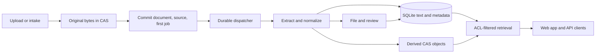

Part of the [architecture guides](/architecture). This page follows a document from capture to its stored, filed state. Confirm contracts against source and tests.

## Capture and processing

`UploadDocument` requires write scope, enforces the body limit and sniffs content
rather than trusting supplied MIME. It streams original bytes to CAS, then opens
one write transaction to recheck authority, deduplicate by system/owner/hash or
insert the document, record provenance and enqueue system-owned `post-ingest` work.
After commit it nudges dispatch and emits audit. A lost nudge cannot lose the job;
re-uploading a live duplicate records its source without another extraction job.

Post-ingest selects the format path and stores extracted metadata/derived bytes.
The common post-content path performs local matching, automations, filing/thumbnail
refresh and optional `post-classify`. Document/version uploads share
`core/api/upload_prepare.go` for multipart validation, rewind-safe MIME detection,
source attribution, CAS and idempotency fingerprints; each owns its transaction
and authorization. Keyed response receipts commit with document/job in
`upload_idempotency`; subsequent keyed uploads prune receipts older than 30 days.

Device OCR is provisional PDF text subject to configured confidence. Native PDF
text remains authoritative; empty extraction cannot erase accepted device text.
`core/mimeutil` owns the normalized document-format registry: MIME aliases,
filename-refinement hints, output extensions, and post-ingest capabilities.
Mail, filesystem intake, post-ingest routing, downloads, and rendered filenames
derive from that registry instead of carrying independent format lists. Byte
sniffing still retains specific valid source types and repairs missing, generic,
or malformed MIME, so rescans can reach PDF encryption handling without rewriting
originals or changing the pipeline revision. [Supported formats](/formats) owns
dispatch, format limits and real-tool requirements.

## Splitting and archive serial number labels

PDF marker analysis and child extraction/CAS work stay outside the writer.
ASN planning first scans every page, then an immutable preflight rejects
malformed or mixed plans and values already retained anywhere in the selected
system. This runs before pre-consume and other mutable hooks. `assign` commits
the ASN on the existing document; `split` stages every derived PDF before one
writer transaction inserts all child rows, ACLs, sources and jobs and retires
the current live parent. No partial child set is visible. Each child inherits
the transaction-current parent system, owner, category, title text, source time
and sensitivity, but starts with automatic title ownership.

`split_origin_id` and its one-based index identify completed parts after parent
retirement. Retrying a completed origin returns those children; upload and
filesystem deduplication do not restore the retired parent over them. A trashed
child makes that result a conflict instead of silently manufacturing a
replacement set. Retry retirement preserves the original Trash deadline.
Legacy disposable separators share the planner but drop marker pages; ASN
marker pages are retained. See [barcode-assisted physical
filing](/formats#barcode-assisted-physical-filing-with-archive-serial-numbers).

## Filesystem and mail intake

Filesystem and IMAP producers use the same document/job transaction pattern.
Filesystem intake is a read-only, polling reconciler: `os.Root` confines opens,
recursive walking retains no per-directory watches, and checkpoints suppress
unchanged work. It skips symlinks, special files, hidden/legacy-error paths,
cross-filesystem directories and excessive depth; source files and sidecars are
never written, moved or deleted. Sidecar metadata, including a requested ASN,
is validated and committed with the document and first job; retained ASN
conflicts leave no partial row. Observation state commits with successful
document/job creation, while bounded failures stay in Suchi-owned storage and
audit. IMAP checkpoints ascending batches of at most 50 UIDs after
import/bookkeeping; failure stops the cycle while preserving earlier progress,
and connection tests do not clear polling failures. [Mail intake](/guides/mail-intake)
owns history/rules/health.
Portable import differs: `core/importer/bundle/` may restore supplied content,
archive bytes and metadata without scheduling extraction.

## Sources and title ownership

`document_sources` records acquisition, separately from identity, version chains
and relationships. One system/owner/hash document may have multiple sources, and
different documents/systems may share CAS bytes. Mailbox history preserves the
observed name/folder after account deletion. Split children/email attachments
inherit sources; each version records its own upload.

`documents.title_owner` is the narrow precedence state for naming: `auto`
allows model or rule naming, `rule` allows a later rule refresh, and `human`
blocks both. API renames and approved title suggestions claim human ownership;
the explicit release operation returns to `auto` without changing text.
Filesystem sidecars preserve an explicit owner and otherwise treat supplied
titles as human; Paperless import is human, new uploads and split children are
automatic, and replacement versions inherit both title and owner. Email subject
parsing cannot replace a non-automatic title. Title and owner changes share
`title_revision`, so in-flight suggestions lose to a later decision.

## Versions, references, and discovery currentness

Acquisition sources, replacement versions, and document links are separate
relations. `document_sources` records where one exact row's bytes came from.
`previous_version_id` and the internal `version_family_key` identify revisions
that supersede one another. A `documentlink` custom-field value connects two
exact rows that continue to coexist. None of these relations is inferred from
shared CAS bytes.

`core/api/versions.go` owns replacement upload and visible family history.
The upload rechecks predecessor change permission inside the single-writer
transaction, gives a previously standalone row and its replacement one random
`v:` family key, inserts the new source and `post-ingest` job with the row, and
copies continuity metadata: system, owner, filing category, sensitivity,
explicit ACL grants, manual tags, correspondents, title, and title ownership.
The ASN moves atomically to the new head and is cleared from the predecessor.
Only a selected folder layout whose template uses `{{ asn }}` follows it;
rendered moves for both affected revisions are enqueued in the same transaction.
Extraction state, accepted intelligence, classifier-owned tags, custom-field
values/document links, notes, non-ASN layouts, and other exact-revision state
start fresh. Every immutable blob remains unchanged. Idempotency receipts and
the predecessor/hash fallback recover a lost successful response without
creating a second version.
Before inserting a non-replay replacement, the same transaction requires the
predecessor to be the greatest remaining family ID and live. A newer or trashed
head returns the same ID-free `version_head_changed` conflict. This makes
concurrent replacement single-winner and prevents Trash/restore from creating
new sibling branches.

When an archive is upgraded, the v0.2.0 metadata migration assigns deterministic
internal `m:` keys to valid pre-existing chains and rejects a cycle or
disconnected predecessor graph before advancing the schema. Family keys are
not a public address. Discovery in `core/api/documents_list.go`, `search.go`,
`intelligence.go`, and `chat.go` uses `core/searchquery` plus
`documentVersionWhere`: by default a family contributes the greatest live row ID
visible to that caller. `version:all` and `version:older` change that selection.
Exact detail IDs, saved snapshots, and Trash remain exact-row operations.

`core/api/custom_field_values.go` owns reference mutation;
`document_references.go` owns typed detail projection and the paged computed
backlink view. An authenticated cross-system write requires change permission on
the source, view permission on the live target, and entry to both systems;
actorless writes stay same-system. Reads return a bounded target summary only
when the exact target is still live and visible. They never substitute a newer
revision or expose a raw stored target ID. Backlink counts/pages put source ACL
and liveness checks inside SQL before pagination. `has-field:` uses the same
exact-target rule inside its `EXISTS`, so hidden or trashed targets behave as
absent without becoming an existence oracle.

Trash suppresses a target from outgoing projections, backlinks, and field
presence without deleting the value, so restore makes it visible again.
Permanent target purge removes incoming `documentlink` value rows before deleting
the document. Replacing either endpoint neither copies nor retargets links.
The mutation helper and schema triggers reject self-links and links within one
version family. Reciprocal or cyclic links between distinct documents remain
valid named relationships, but no API recursively traverses them.
Verify these boundaries with `go test ./core/api ./core/customfield ./core/db
./core/searchquery ./core/trash ./core/authz` and the version/reference browser
workflow in `ui/tests/document-versions-references.spec.js`.

## Typed metadata and folder layouts

`core/api/document_notes.go` owns attributed, exact-revision notes. Document
Detail projects them with author/admin edit authority. Create, update, and delete
recheck the document ACL and current writer inside the single-write transaction;
replacement creates no note rows for the new revision.

`core/api/custom_fields.go` owns definitions and protects stored values from
schema drift: choice fields require normalized choices, a populated field cannot
change type, and an in-use choice cannot disappear. `custom_fields.managed_by`
records extraction-owned definitions. Upgrading adopts compatible existing
`invoice_*` rows, database triggers reject definition mutation/deletion, and
`core/pipeline/zugferd` creates or adopts the same typed fields transactionally.
The API reserves those names and reports the extraction owner on managed
definition and document-value rows. Per-document values remain ordinary editable
typed values. `core/customfield` remains the
single validation/write/render dispatch for API values, filesystem sidecars,
automations, and imported values. `document_references.go` projects typed raw
values, formatted display values, and choice metadata while retaining exact-link
ACL behavior. `core/searchquery` resolves `field:` against the system-local
definition before compiling the matching typed column; `has-field:` remains the
presence operator.

The UI presents filesystem-view templates as **Folder layouts** under Advanced.
The wire boundary remains `/api/rendered_layouts/`;
`core/api/taxonomy_crud.go` validates templates and serves sample previews.
Existing archives retain the internal `storage_paths` table,
`documents.storage_path_id`, and persisted automation action names. The public
bulk method and ACL kind are `set_rendered_layout` and `rendered_layout`. A
document with no selection uses the default filing-tree projection. Document
PATCH, bulk actions, automations, template edits, and layout deletion enqueue
rendered moves in the same transaction as their state change.

`archive_serial_number` is system-scoped physical-filing metadata. A document
PATCH accepts a positive JSON-safe integer or `null`; assignment is limited to
the live current version, while clearing is allowed on Trash and history to
resolve retained conflicts. Uniqueness spans live rows, Trash and historical
versions. Same-value writes are idempotent. Document Detail edits the value, and
list, search, Trash and version projections render the same **ASN _n_** chip.
`core/searchquery` supports numeric comparisons and null retrieval through
`asn:`, and source-bundle saved-view import maps exact, missing, greater-than,
and less-than rules to that query syntax. A layout using the exact `{{ asn }}`
variable is marked in previews/lists and cannot be assigned to a document
without a value. Combined ASN/layout writes validate their resulting state
before committing.

`core/api/setup.go` owns session-admin GET/POST for the live scan controls.
`core/settings.ResolveScanConfig` combines stored rows with boot-pinned
environment/config values and reports each pin to the API. A save that changes
a pinned value fails before the writer; accepted saves update only unpinned
rows, preserving the stored value beneath each deployment override.
`distro/app` validates the result against the boot-only legacy separator token
and publishes one atomic `postingest.ScanSplit` snapshot.
`core/pipeline/postingest` captures that snapshot once at job entry, so a
running PDF cannot mix settings while later jobs observe a successful save
without restart. Failed live validation restores the prior settings rows before
the API returns.

Verify these boundaries with `go test ./core/asn ./core/pipeline/docsplit
./core/pipeline/postingest ./core/ingest/fswatch ./core/ingest/sidecar
./core/api ./core/automations ./core/customfield ./core/db
./core/importer/bundle ./core/searchquery`, `make smoke-asn`, and the Document
Detail/Filing Tree browser workflows.
