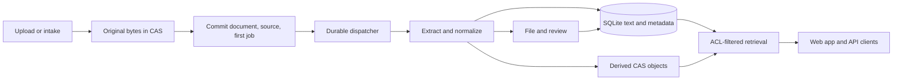

Suchi captures, extracts, files, retrieves and reviews documents locally. Each
step remains useful without an LLM or external service. The production runtime
is one static Go binary with an embedded Svelte app, SQLite, immutable CAS blobs
and rebuildable filing views under `DATA_DIR`; no database server, cache or broker.

This guide and the pages it links describe the current checkout. Confirm
contracts against source and tests; linked feature guides own detailed user and
wire behavior.

## Architecture guides

| Guide | Owns |
| --- | --- |
| [Runtime, jobs, and integrations](/architecture-runtime) | Boot and shutdown, archive locking, durable jobs, subprocess bounds, model and subscription integrations |
| [Document lifecycle](/architecture-documents) | Upload and intake, splitting, sources, title ownership, versions, links, notes, typed metadata, folder layouts, archive serial numbers |
| [Storage and transaction invariants](/architecture-storage) | The single writer, filing systems, CAS, rendered paths and journals, migrations, extension ledgers |
| [HTTP and security boundaries](/architecture-security) | Middleware, the share-only listener, authentication and authorization gates, pairing, demo identities, blob delivery |
| [Retrieval, filing, and human review](/architecture-filing) | Search, automations, approvals, filing-tree changes, document dates, automatic application |
| [Frontend architecture](/spa-architecture) | Browser source layout, build and embedding, routing, request lifetimes, wording, localization, browser security |
| [Frontend: document screens](/spa-document-screens) | Documents, Trash, Detail, Views, Calendar, upload, sharing, approval cards |
| [Frontend: settings and account screens](/spa-settings-screens) | Archive Configuration, tags, filing trees, models, automations, people, account email, tokens, pairing |

## How a document flows



[Document lifecycle](/architecture-documents) follows each step.

## Where to start a change

| Concern | Entry point and owner |
| --- | --- |
| Lifecycle and wiring | `distro/cmd/suchi/main.go` parses configuration/signals; `distro/app/app.go: Run` and `serve_*.go` assemble services and HTTP policy |
| JSON contracts | `core/api/api.go: Server.Register`; feature handlers in `core/api/` |
| Browser/blob delivery | `core/ui/ui.go`, `core/ui/spa.go`; `core/uiassets` verifies generated browser builds; `distro/app` wires API preview/download mirrors |
| Localization | `core/i18n` validates server catalogs and negotiates request locales; account preference is stored on `users`, exposed by `core/api/users.go`, and shared with `core/ui` server-rendered pages |
| Identity/access | `core/auth/`, `core/authz/`, `core/httpx/`; credentials in `plugins/local-auth/`, `plugins/oidc/` |
| Durable state/work | `core/archivelock` owns process-level archive exclusion; `core/db/db.go`, `core/db/migrations/`, `core/blob/cas.go`, `core/jobs/jobs.go` |
| Capture/processing | `core/api/documents.go: UploadDocument`, `core/ingest/`, `core/importer/bundle/`, `core/pipeline/postingest/` |
| Filing/review/retrieval | `core/jd/`, `core/automations/`, `core/approvals/`, `core/searchquery/`, `core/intelligence/`; API projections in `core/api/` |
| Portable taxonomy | `core/jd/presetfile` validates/normalizes HuML/TOML; `core/jd/importer` previews/applies; `core/taxonomy/exporter` exports |
| Filing projections | `core/render/index` writes tree-only indexes; `core/render/view` owns document paths |
| Browser app | `ui/src/`; see [Frontend architecture](/spa-architecture) |

Keep behavior with its domain owner. `plugin-api/` provides vocabulary for
compile-linked authenticators, job subscribers and audit sinks, without a runtime
Go plugin loader or service framework. The shared assembly injects integration
callbacks into the API instead of importing `plugins/*` there and provides one
boot-time callback for compiled native routes and durable subscribers. See
[Plugins](/plugins).

`core/approvals/document_change.go` owns review eligibility together with source,
field-generation, access and session validation. The classifier records bounded
review reasons; Suchi's approval transaction performs the final checks and write.
See [Review-first mode](/approvals#review-first-mode).

## Change and verification map

Start at the affected boundary, then run the aggregate loop.

| Change | Focused verification |
| --- | --- |
| Routes, scopes, credentials, ACLs | `go test ./core/auth/... ./core/authz/... ./core/httpx/... ./core/api/... ./core/ui/... ./distro/app/... ./distro/cmd/suchi/...`; denied principals, aliases, counts, direct blobs |
| Query/filter semantics | `go test ./core/searchquery/... ./core/api/...`; Search/Documents parity and hidden-document exclusion |
| Ingest/format tools | `go test ./core/ingest/... ./core/pipeline/... ./core/sandbox/...`; originals, retries and affected real-tool smoke tests |
| Queue/concurrency | `go test -race ./core/jobs/... ./distro/app/... ./distro/cmd/suchi/...`; backlog, cancellation, restart recovery |
| Schema/blobs/deletion | `go test ./core/db/... ./core/blob/... ./core/trash/... ./core/gc/... ./core/importer/bundle/...`; migrations/shared blobs |
| Filing/model/review | `go test ./core/automations/... ./core/approvals/... ./core/intelligence/... ./plugins/llm-classifier/...`; human decisions/no-model operation |

```sh
GOCACHE=/tmp/suchi-go-cache go test ./core/db ./core/automations ./distro/app ./distro/cmd/suchi
GOCACHE=/tmp/suchi-go-cache go test -race ./core/automations ./core/approvals ./core/api ./distro/app ./distro/cmd/suchi
GOCACHE=/tmp/suchi-go-cache make check        # Go formatting/vet/tests/staticcheck; UI and embedded parity
GOCACHE=/tmp/suchi-go-cache make smoke        # build and disposable-server health/readiness
make docs-check   # documentation links
```

Use writable `GOCACHE` when restricted; force re-execution with
`make test TEST_FLAGS='-count=1 -timeout 60s'`. Race tests need CGO. UI changes also
need `make ui` and relevant browser regressions. Use focused benchmarks for local
performance claims and `make bench-check` for startup/memory/binary guardrails.

Update this guide when ownership, entry points, state flow or invariants change;
update owning feature/API guides and changelog for observable changes. Report
missing runtime/real-tool checks: mocks do not establish end-to-end compatibility.
