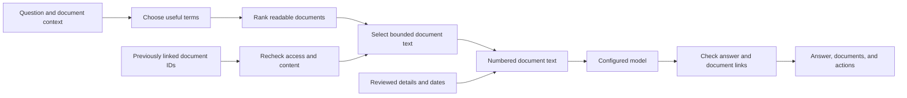

**Ask your documents** is a read-only way to ask questions across files you can
open. Suchi finds a small set of relevant documents, sends only selected
document text to the configured OpenAI-compatible model, checks every numbered
document link, and keeps those links beside the answer.

The answer cannot change documents or open another screen on its own. Saving the
document set as a View, reviewing a suggested date, or opening Calendar happens
only when the user follows a link. Dates are the first suggested-detail type;
later extractors can use the same storage and review path for other details.

This feature is unavailable in the desktop-local profile because model
connections are disabled there. Use a server deployment to enable it; local
search and filing remain available in the desktop app.

## User workflow

1. Enter a question in the global Omnibox and select **Ask your documents**, or
   select documents on the Documents screen and choose **Ask selection**.
2. Suchi opens **Ask your documents** and names the current document context in
   the header.
3. The server finds at most six relevant documents that the user can open.
4. The model returns one structured answer with numbered document links.
5. Suchi rejects malformed or out-of-range document numbers before showing
   anything.
6. The user can open a linked document or explicitly continue to Views,
   Approvals, or Calendar when the answer offers that action.

Follow-up questions can reuse up to three documents linked from the preceding
successful answer. The server checks access and reloads those documents; prior
assistant text never becomes document text.

## How a question is answered



### How documents are found

Ask your documents uses a bounded, broad text match instead of interpreting the
question as a rich query. Term selection, prefix matching, BM25 weights,
follow-up documents, and the distinction from ranked Search are centralized in
[Search architecture: Document-question retrieval](/search#document-question-retrieval).

### Text and document limits

- At most six documents per answer.
- At most three documents linked from the prior turn.
- Titles sent to the model are limited to 300 Unicode characters. Document text
  follows the administrator's **Reading depth** preset described below.
- Reviewed details are limited to three per document and twelve total; the
  response summary still counts every visible detail by status. Their existing
  1,600-character value and quote limits do not grow with Reading depth.
- Follow-up document IDs are loaded in requested order without a prior-term test.
- Model generation is capped at 4,096 tokens, including provider reasoning where
  applicable; the visible answer remains capped at 6,000 characters.
- One provider call per successful turn.

No provider call occurs when no relevant document text is found.

### Reading-depth presets

An administrator chooses one global preset under **Settings → Archive
configuration → Classification**. A missing or invalid stored value resolves to
**Balanced**. Saving the reading depth affects the next question immediately; it
does not reload or enable the model, change credentials, apply dates, clear an
open question drawer, or require a server restart.

| Preset             | Matching sections per document | Text limit per document | Maximum across six documents |
| ------------------ | -----------------------------: | ----------------------: | ---------------------------: |
| Focused            |                              1 | 1,600 Unicode characters |             9,600 characters |
| Balanced (default) |                              2 | 3,200 Unicode characters |            19,200 characters |
| Detailed           |                              3 | 4,800 Unicode characters |            28,800 characters |

A matching section is one FTS text window; the optional distinct document ending
is not counted as another section. That ending and Suchi's separators still
count toward the per-document text limit. Titles, the question, bounded history,
and permitted reviewed details are separate parts of the model request. The
six-document maximum does not change.

For a long matching document, Suchi keeps the first section found from the
complete normalized question. Balanced and Detailed can add distinct sections
for individual terms in question order. Each FTS5 section uses SQLite's maximum
64-token snippet window. Suchi temporarily marks the first match, clips around
it, removes every marker, and retains at most 1,200 Unicode characters. This
keeps the match even when an unusually long token pushes it beyond the first
1,200 characters of SQLite's snippet. Whitespace-equivalent, duplicate, and
contained sections are removed. When space remains, a distinct document ending
is appended so receipt totals, signatures, and closing clauses are less likely
to disappear.

A document whose complete extracted text fits the selected limit is sent whole.
One restricted FTS query checks every linked follow-up document for the complete
current question, so a match cannot be displaced by six better-ranked
documents and Focused mode still receives it. A long linked document with no
current match uses a bounded beginning-and-ending fallback. The `snippet`
returned to the browser is byte-for-byte the document text supplied to the
model, so the reader and provider see the same text under each document number.

Authorization, document-context resolution, content, FTS sections, and fallbacks
are read through one read-only SQLite WAL snapshot per question. A concurrent
ACL, sensitivity, Trash, or content change therefore appears either before that
read or on the next one, never halfway through one document set.

Focused is the safest starting point for small local models or tight context
windows. Balanced is recommended for most local and hosted models. Detailed is
best reserved for models with enough context capacity when important text is
likely to be repeated or far apart in long documents. It can increase latency,
hosted token cost, and the amount of authorized document text sent to the
configured provider.

Detailed improves coverage; it is not exhaustive analysis of every repeated
occurrence in a very large document. Check totals and other high-consequence
claims against the linked documents.

Every document context below is bounded by the current filing system plus
membership and document permissions. Initial matches, prior-turn IDs, reviewed
details, pending suggestions, and selected text use that boundary; a
multi-system member cannot ask one question across both systems. Switching
systems destroys browser conversation state and rejects late responses. Shared
model configuration and FTS/CAS infrastructure do not make documents from
another filing system available.

## Document context

The question drawer supports these server-enforced document sets:

- all accessible documents;
- the current [rich-query](/query-language) result;
- the current Johnny.Decimal category;
- the exact visible sensitivity, type, tags, correspondents, created-time
  bounds, and language filters published by Documents or Search;
- the current document; or
- up to 100 explicitly selected documents.

These fields combine to narrow which documents can be found; they never grant
access. Every query still applies the user's document permissions, Trash
exclusion, and sensitivity rule.

## Answer links and provider contract

Suchi requests OpenAI-compatible JSON-object response mode. The provider must
then return this schema:

```json
{
  "answer": "The policy expires on September 14, 2026.",
  "citations": [1],
  "sufficient": true
}
```

Provider requirements are listed under
[LLM classifier: Hosted providers](/llm-classifier#hosted-providers).

Validation requires a non-empty bounded answer and every `citations` number to
be between `1` and the number of supplied documents. `citations` is the API
field that powers the numbered document links; Suchi adds any missing inline
`[n]` markers after validation. Existing inline markers remain accepted for
provider compatibility and can supply the list when the array is empty.
Contradictory or out-of-range document numbers are rejected.

These checks verify the response format and document numbers. They do not prove
that every claim follows from the linked text. Open each document to check the
answer.

When `sufficient` is false, or a nominally sufficient answer supplies no
document numbers, Suchi returns a stable answer explaining that the documents
were insufficient and keeps the same document boundary. Malformed responses
and invalid document numbers return `502 invalid_provider_response`.

A provider response with `finish_reason: "length"` returns
`502 provider_response_truncated`, even if its partial text happens to be valid
JSON. Suchi never displays that partial answer or retries automatically. Try a
narrower question or another model if the provider repeatedly reaches its output
limit. Other provider failures return `502 provider_failure`.

Document text remains untrusted prompt data. The system instruction tells the
model to ignore role changes and instructions inside that text. Ask your
documents has no tools and no write operations, limiting prompt-injection impact
to the proposed answer.

## Conversation state

Conversation state exists only in the mounted browser application.

- Closing the drawer preserves it.
- **Clear** deletes it and resets sensitive-document consent.
- Changing the document context or configured provider resets both the
  conversation and sensitive consent. Disabling sensitive consent clears
  accumulated history.
- Only complete successful question/answer pairs enter history.
- Failed and canceled turns cannot affect later role alternation.
- The drawer retains the newest 20 turns, bounding long-session DOM and text
  memory without changing the smaller provider-history limit.
- Only the newest complete pairs fitting four messages and 12 KB are sent.
- Follow-ups carry only documents linked by the preceding successful answer;
  other documents found for that answer are not used as implicit context.
- The server stores no conversation rows.

## Save these documents as a View

**Save these documents as a view** creates a snapshot with `document_ids`
instead of trying to reconstruct the result from question words. The View
contains the documents listed under **From your documents**.

Opening or sharing the View checks document access again. A shared snapshot
therefore exposes only the listed documents each viewer can already open.
Snapshot Views contain at most 100 IDs; Ask your documents currently contributes
at most six.

Live Views use the explicit [query language](/query-language); approved dates
participate in its `date:` and `date-role:` filters. Ask your documents never
creates that live query from question words.

## Suggested dates and saved details

`document_intelligence` is the shared review ledger for extracted facts. Its
stable columns cover every registered fact type:

- source document;
- `intelligence_type` and semantic `role`;
- validated `value_json` plus an indexed `sort_value`;
- original text, evidence quote, and optional source offset;
- confidence;
- `pending`, `accepted`, or `rejected` state;
- extractor, source blob, and extraction version; and
- reviewer and review timestamp.

Type-specific validation lives in `core/intelligence`. Adding a type requires a
small explicit value contract there, an extractor projection, and a UI renderer.
It does not require a new approval table or state model.

### Date extraction, review, and Calendar

Dates use this ledger without adding a second model completion. For the roles,
validation rules, model-score signals, automatic or reviewed dates, legacy facts, rescans,
Approvals, and Calendar, see
[Document dates](/document-dates).

Dates available to Calendar may be included beside text from their original
document in a later answer. The original document remains linked.

**Open N calendar dates** counts accepted dates across all documents found,
including documents the answer did not link inline. It opens their all-dates
agenda, not just the currently displayed calendar range. See
[Document dates: Ask your documents links](/document-dates#dates-linked-from-ask-your-documents)
for filters and pagination.

## Authorization

Ask your documents requires:

- authentication;
- `documents:read`; and
- the `archive_chat` capability, implicit for administrators.

Reviewing extracted facts, running extraction, and using Calendar require
`archive_intelligence`, also implicit for administrators. Calendar dates are
readable document metadata, so `documents:read` is sufficient for `date:` and
`date-role:` predicates. Extraction and review mutations additionally require
`documents:write` and Change permission on every source document.

Public demo sessions are denied both capabilities. A narrow Calendar read
exception exposes accepted, curated `demo-corpus` dates from visible documents;
it grants no access to model output, extraction, review, or Ask your documents.

Document matching, saved document sets, suggested-detail lists, details used in
answers, and Calendar queries all apply document ACLs inside SQL. Confidential
and Restricted text is excluded from questions until the user enables the
per-conversation option. With consent off, only unset, Public, and Internal
sensitivities are eligible; unknown values fail closed.

## Provider privacy

The model transport is the same one used by classification:

- disabled when no endpoint is configured;
- non-local endpoints require explicit egress acknowledgement;
- redirects are refused;
- API keys never return to the browser;
- response bodies are bounded; and
- provider errors are sanitized.

The drawer identifies the local model or hosted model service receiving document
text. For each question the provider receives the question, allowed complete
history pairs, and each selected document's title, sensitivity, text, and—when
the user has `archive_intelligence`—accepted detail value and quote. It receives
no ACL rows or unrelated document metadata.
The assembly event records only the chosen reading-depth mode, matching-section
count, document count, and bounded text size. Failures add a fixed reason such
as `output_limit`, `invalid_answer_json`, or `citation_out_of_range`; provider
bodies and decoder error text are never logged. Separate operational events
still record the normal HTTP method, path, status, byte count, duration, and
request ID; calls to a hosted model also record its host and model name.
Sanitized failures may be logged. None of these events includes questions,
answers, titles, document text, or extracted quotes.

## Abuse controls

Document questions have three in-process controls:

- six questions that send document text per minute per authenticated user, burst two;
- at most two simultaneous multi-section document matches per Suchi process; and
- at most two simultaneous model completions per Suchi process.

A rate token is reserved before document matching, preventing rate-limited
requests from running text queries, and is returned when matching cannot start,
fails, or finds no text eligible for the model. Matching owns one reader
connection and does not occupy a provider-call slot. A refusal returns
`429 chat_rate_limited` and `Retry-After`. Reverse proxies may apply an
additional distributed limit.

## HTTP API

### Status

```http
GET /api/chat/status
```

```json
{
  "enabled": true,
  "provider": "localhost",
  "local": true
}
```

### Ask

```http
POST /api/chat
Content-Type: application/json
```

```json
{
  "question": "When does it renew?",
  "history": [
    { "role": "user", "content": "Which office lease applies?" },
    { "role": "assistant", "content": "The Indiranagar office lease [1]." }
  ],
  "context_source_ids": [17],
  "scope": {
    "query": "tag:lease",
    "document_ids": [],
    "jd_category_id": 0,
    "sensitivity": "internal",
    "tag_ids": [8],
    "correspondent_ids": [12],
    "created_at_gte": 1788134400,
    "created_at_lte": 1790726399,
    "language": "en"
  },
  "include_sensitive": false
}
```

`context_source_ids` accepts at most three cited IDs. The response includes
`answer`, `sources`, `citations`, `grounded`, and an
`intelligence` summary. Facts available to answers appear under their source's
`intelligence` field.

### Extracted facts

```http
GET  /api/intelligence/schema
GET  /api/intelligence/?status=pending&type=date
POST /api/intelligence/extract
POST /api/intelligence/resolve
```

Extraction request:

```json
{
  "document_ids": [17, 28],
  "types": ["date"]
}
```

Resolution request:

```json
{
  "candidate_ids": [71, 72],
  "decision": "accepted"
}
```

List filters include `status`, `type`, `role`, `sort_from`, `sort_to`,
`document_ids`, `view_id`, `q`, and normal pagination. `q` uses the same rich
query compiler as Search and Documents. `view_id` is resolved server-side and
applies the complete owned/shared View filter plus document ACLs.

The document-scoped Calendar agenda uses this same list endpoint with
`status=accepted`, `type=date`, `document_ids`, `page`, and `page_size=500`, without
`sort_from` or `sort_to`. Results remain in chronological order across pages;
the optional `role` filter still applies.

## Maintainer file map

| Concern                            | Location                                            |
| ---------------------------------- | --------------------------------------------------- |
| Question request, document matching, link checks | `core/api/chat.go`                                  |
| Question rate and concurrency gate               | `core/api/chat_gate.go`                             |
| Suggested-detail API                             | `core/api/intelligence.go`                          |
| Suggested-detail value contracts                 | `core/intelligence/intelligence.go`                 |
| Suggested-detail schema                          | `core/db/migrations/0002_document_intelligence.sql` |
| Single-call model contract                       | `plugins/llm-classifier/llm.go`                     |
| Suggestion persistence                           | `plugins/llm-classifier/handler.go`                 |
| Rich query date predicates                       | `core/searchquery/`                                 |
| Question drawer                                  | `ui/src/lib/ArchiveChat.svelte`                     |
| Review workspace                   | `ui/src/routes/Tasks.svelte`                        |
| Calendar                           | `ui/src/routes/Calendar.svelte`                     |

## Operational checks

Use a real configured model when changing either prompt contract:

1. Classify a long document with a date near the middle.
2. Confirm the suggestion remains pending and includes the matching text.
3. Approve it and confirm it appears on Calendar.
4. Ask a question whose answer uses the Calendar date.
5. Confirm the response JSON has valid document numbers and the document opens.
6. Ask a pronoun-based follow-up and confirm the previously linked document
   remains in the selected set.

Unit tests pin value validation, conservative date suggestions, ACL behavior,
document-number validation, request limits, exact Views, rich-query parity,
approval, and Calendar rendering.

## Current limits

- Document matching uses lexical FTS5, not semantic embedding search.
- Questions are intentionally transient and read-only.
- The classification call suggests at most three dates per document.
- Relative dates that cannot be normalized from explicit document text are ignored.
- Extracted dates represent all-day archival facts; timed events and timezones
  are outside the current contract.
- Fact rules are never learned implicitly from one approval.
