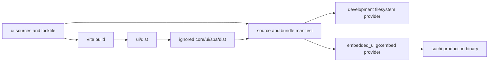

Part of the [architecture guides](/architecture). Suchi's primary UI is a Svelte 5 application under `ui/`, embedded in the Go binary. Server-rendered pages cover bootstrap and direct preview/download responses. This guide owns frontend implementation contracts; [Web app](/web-app) owns user actions and labels, and the [API reference](/api) owns wire contracts.

## Source layout

```text
ui/src/
  App.svelte                  shell, navigation, route selection
  app.css                     global tokens and component styles
  lib/api.js                  transport, errors, named API operations
  lib/system-routing.js       filing-system catalog and route entry
  lib/router.svelte.js        sole hash router
  lib/session.svelte.js       principal, session, theme
  lib/systems.svelte.js       accessible systems and request generation
  lib/Lazy.svelte             deferred route/component loading
  lib/*.svelte                shared feature components
  routes/*.svelte             screen-owned state and behavior
```

Keep state in its screen unless multiple screens coordinate through it. Shared
modules remain small; there is no general client cache or state framework.
The [wording inventory](#interface-wording) identifies shared value helpers.

## Build and embedding



Use:

```sh
make ui        # install, build, refresh ignored assets, and write their manifest
make ui-check  # diagnostics, tests, production build, manifest and repository guard
make build     # regenerate assets and compile the embedded production binary
```

`core/ui/spa/dist` is generated and never tracked. Its manifest binds the
generated bytes to `ui/src`, `ui/public`, `index.html`, `package.json`,
`bun.lock`, and `vite.config.js`; it also requires the web manifest, hashed
entry script, and distributed third-party notices. A new file emitted anywhere
under `dist` is included automatically. A new build input outside the listed
paths must be added to `core/uiassets.sourceInputs` in the same change. The
default development Go build verifies that manifest and serves the generated
directory from disk. Missing or stale assets panic during server assembly with
instructions to run `make ui`. Production paths compile with `embedded_ui`,
where `go:embed` requires the generated tree at compile time.

`core/uiassets` owns deterministic source/bundle hashing and bundle-contract
validation. `hack/ui-assets` is the build command used by Make, CI, and Docker;
runtime code imports only the verifier, never the command.

GitHub Actions builds the browser assets once from the immutable target revision
and passes the verified artifact to tagged Go test and cross-build jobs. Release
binaries consume the same revision-named artifact. Docker builds the UI in its
pinned Bun stage and copies only `ui/dist` into the Go stage; Bun and
`node_modules` do not enter either runtime image. All paths preserve a single
offline binary and serve `third-party-notices.txt` with the application.

Settings reads `build_version` and optional `build_revision` from the existing
`/api/whoami` session response. The executable supplies this identity once at
startup through `app.Options` from release linker values or Go VCS metadata,
not `ui/package.json`. Shared server assembly does not change browser ownership,
routes, or the embedded bundle.
Do not add a separate frontend version, version request, or update checker.
Tagged production builds show only the version in Settings; development builds
also show the source revision. The CLI's `developmentVersion` owns the default
source version line when no release version was injected.

`App.svelte` loads every route, including login and dashboard, through the existing
`Lazy.svelte` component. There are no route
re-export wrappers. A native Rolldown group keeps the shell, API client, filing
context and their static dependencies together. A separate group combines small
document controls (including the shared type-to-select picker), link display,
clipboard/query helpers, upload-list refresh state and the shared configuration
link inventory; other shared dependencies use normal chunking.
The shared password-unlock indicator belongs to this group and reads the
existing encryption state exposed by document list and detail responses.
The QR encoder remains a separate on-demand import. My account defers archive configuration and loads
mailbox code only for members who can manage mailboxes.
Keep the shell at or
below 36 KiB gzip (35 KiB for the English-only shell plus the localization
runtime) and remeasure the actual route dependency set after UI changes.

Measure the current production graph rather than assuming historical route sizes.
Settings, research, and QR code generation remain deferred. Filing context lives
in the shell; the system membership editor loads with archive configuration.
Static assets are shared normally by the browser, not by an application cache.
`ui/src/bundle.test.js` builds the production graph in memory and checks the
36 KiB initial budget, document request count, deferred features, and static
dependency cycles. Production browser tests use
`PLAYWRIGHT_PRODUCTION=1 bun run e2e`; preview serves its built assets locally
and proxies only backend routes.

```sh
make ui
for asset in ui/dist/assets/*.js; do
  printf '%s ' "$asset"
  gzip -nc "$asset" | wc -c
done
```

## Routing and loading

`router.svelte.js` owns hash state; `App.svelte` chooses routes and persistent
navigation. Screens support reload, Back/Forward and narrow layouts through this
router, without a second navigation registry.

### Filing systems and request lifetimes

`GET /api/jd/systems` is authoritative. `systems.svelte.js` stores only its
accessible list, introduced state, current code and account/system generation.
Before first prefixed import, the empty list preserves unprefixed UI and URLs;
introduction is not a browser preference. [Filing systems](/jd) owns import and
storage semantics; [Permissions](/permissions) owns authorization.

`App.svelte` waits for identity and the catalog before mounting collection screens
or requesting tree/counters. An unqualified route selects the accessible original
system, otherwise the first enterable system, and writes `system=CODE` before
collection reads. An explicit unavailable system never falls back. No-access
screens offer profile/sign-out without document-bearing settings requests.

An unqualified numeric document link loads the authorized document intrinsically;
its returned `system_code` binds the route, sidebar and subsequent metadata/blob
requests. Full addresses use `/api/jd/resolve`; stale addresses are errors, never
aliases or broad searches. Display the server's `jd_address`; address and private
numeric links are copyable. Category pickers stay two-level within the system.

Native links and `go()` use the scoped hash helper. Switching drops foreign
filters/IDs and increments generation. The shell keys its scoped subtree by that
generation, clearing tree, counters, selections, Reveal, upload/share/pairing/
import/OAuth dialogs and parked research. Expansion state uses
`suchi.jd.open.<user>.<system>`; theme is presentation-only. Route abort/version
guards still reject superseded reads within one generation.

API helpers capture complete URLs before requests and reject older account/system
responses. Single-flight GET keys include generation and full URL. Blob links and
text taxonomy exports use the same captured destination; exports share transport,
logout guards and structured errors. A current-system `system_unavailable` clears
the surface. Continuing upload or pairing-cleanup errors from a previous system
cannot invalidate the current one. All new upload entry points, including window
drops, require the route's system to be ready.

Dependencies stay one-way: `system-routing.js` → `api.js` → `systems.svelte.js`.
Catalog refresh/route entry live in the first module; synchronous scope helpers
live in the last, which has no API dependency. Browser guards prevent stale
display; the server enforces access.

`SystemSettings.svelte` edits the current name and complete explicit membership
set for admins after introduction. Browser directory pages do not own that set:
off-page/inactive grants survive until removed explicitly. Admin access is implicit
and read-only; codes are permanent and there is no delete-system control. Filing
configuration, metadata, rules and mailboxes are scoped; identity, watched-folder
configuration, OCR/models and backups remain visibly server-wide.

Screen-level behavior lives in [document screens](/spa-document-screens) and
[settings and account screens](/spa-settings-screens).

## API conventions

Components call named `api.js` operations, which own fetch and error parsing;
`net.js` handles local-endpoint validation. Add and test new server contracts
before using them in a screen. API field names may stay technical; visible labels
follow [Web app](/web-app).

## Interface wording

| Vocabulary | Source |
| --- | --- |
| Navigation and titles | `App.svelte` |
| Archive Configuration sections | `lib/configuration.js` |
| Capabilities | `lib/capabilities.js` |
| Dates, sizes, sensitivity | `lib/format.js` |
| Saved-view filters and browser parameters | `lib/documentFilters.js` |
| Intelligence roles/values | `lib/intelligence.js` |

Import shared values instead of duplicating them. Update the owning feature guide,
[Web app](/web-app) and relevant browser regression when labels/behavior change.

### Localization

Browser messages live in `ui/src/i18n/locales/<locale>.json`; server-rendered
bootstrap, sign-in, setup, and share-page messages live in
`core/i18n/strings/<locale>.yaml`. `core/i18n.Registry` negotiates persisted user
preference, `suchi_locale`, and `Accept-Language` for server pages. The SPA uses
the same persisted preference, then the locale cookie and browser languages.
An unsupported locale falls back to English. A missing translated browser
message falls back to its English entry, then to the stable message key.

Keys use `<feature>.<lowerCamelName>`. Keep an existing key stable when English
wording changes. Count-sensitive messages add CLDR category suffixes such as
`.one` and `.other`; locale-only `.zero`, `.two`, `.few`, and `.many` entries
are allowed when that language requires them. Placeholders are named, not
positional, and every locale must preserve the English placeholder set.

`lib/i18n.svelte.js` owns reactive locale state and interpolation.
`lib/locale-runtime.js` discovers and validates deferred catalogs.
`lib/format.js` owns `Intl` date, number, list, collation, and plural helpers.
Catalog metadata supplies `ltr` or `rtl`; applying a locale updates both
`<html lang>` and `<html dir>`. Do not assemble sentences with translated
fragments, lowercase translated labels to make grammar fit, or choose English
plural suffixes in components.

Adding a locale requires a complete browser catalog and matching server catalog.
Run `bun test src/lib/i18n.test.js` for catalog parity, placeholder, fallback,
plural, and locale-format checks; use a real browser smoke run to verify the
profile selector and document root attributes.

## Security

Login/demo authentication uses HttpOnly cookies. The SPA does not persist
session, mailbox, provider, or account-password credentials; freshly issued
tokens/pairing secrets remain in memory for their explicit handoff. The email
dialog's password exists only in component memory for one attempt and is erased
across every exit and failure path. Concurrent demo writes share one upgrade;
login/logout and successful email rotation invalidate reads/retries and abort
unfinished work. Scratch identity remains restricted for API and direct
resources. Cookie mutations pass server same-origin/Fetch Metadata checks.

Serve previews through dedicated endpoints with restrictive CSP. Render ordinary
text through Svelte escaping; sanitize marked-up search snippets
before display. Destructive confirmations use `ConfirmDialog.svelte`, backed by
the native `<dialog>` element for Escape, focus return, and an inert background;
screens never call `window.confirm`. Browser visibility never substitutes for
server authorization.

## Adding or changing a screen

1. Reuse named API operations, existing route registries and shared controls.
2. Keep screen state in `routes/`; cover loading, empty, failure and permission states.
3. Check desktop/mobile, keyboard behavior and text overflow.
4. Update the owning user/architecture guide and run relevant API integration tests.
5. Run `make ui-check`; generated embedded assets remain ignored.

Keep dependencies rare; a package should remove more maintained code than it adds.
Additional verification:

```sh
cd ui
bun run check
bun test src
bun run e2e --grep 'password-managed|email-change secret|provider reauthentication|disabled account email|enlarged mobile viewport'
PLAYWRIGHT_PRODUCTION=1 bun run e2e
```

Production preview serves built assets and proxies backend routes only. The
controlled-response `filing systems` cases cover delayed reads, account races,
captured uploads, deep links/history, no-access controls, first import, membership
paging/name changes, pairing/share/OAuth cleanup and parked research. These verify
compiled browser lifetimes, not server isolation: real-server checks must also
exercise membership, document ACLs, delegated credentials and import/render work.
